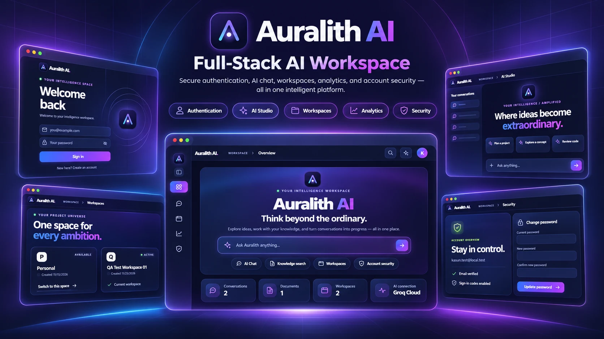
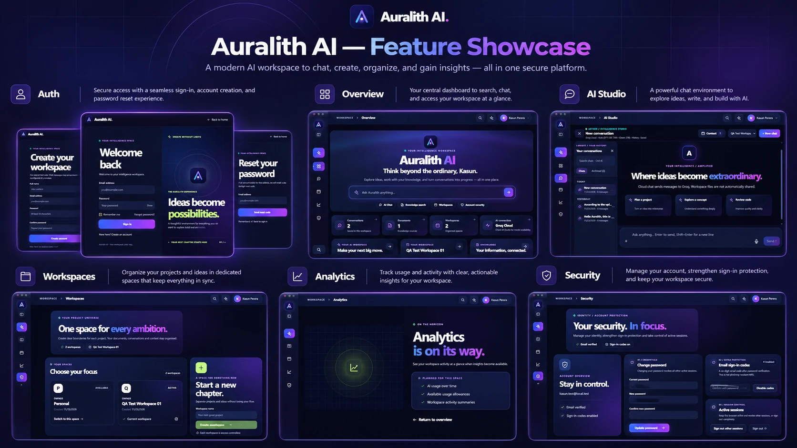
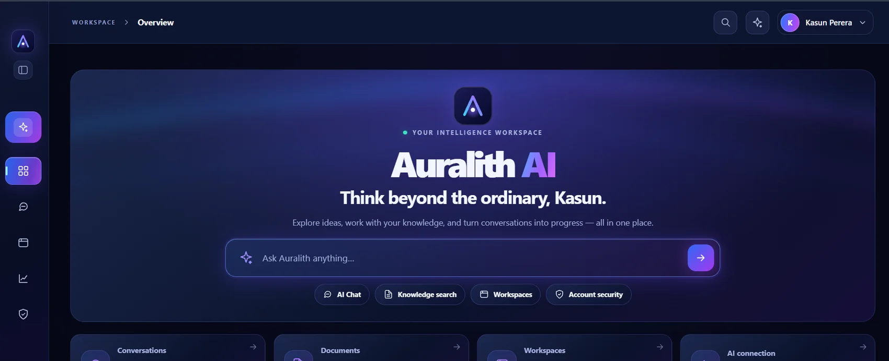
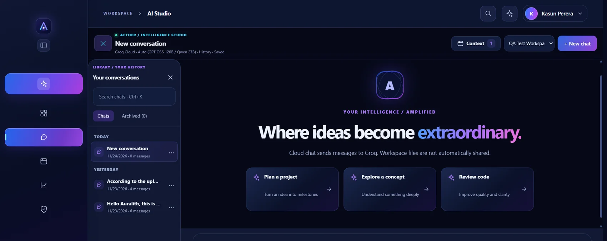
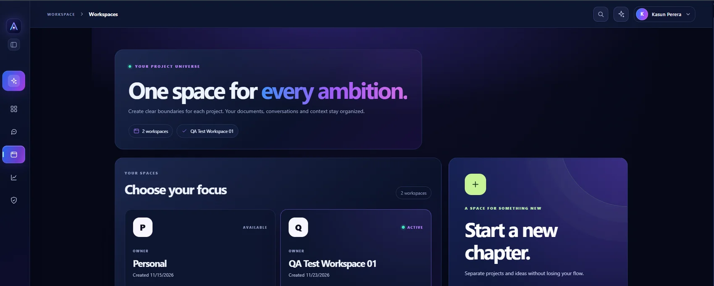
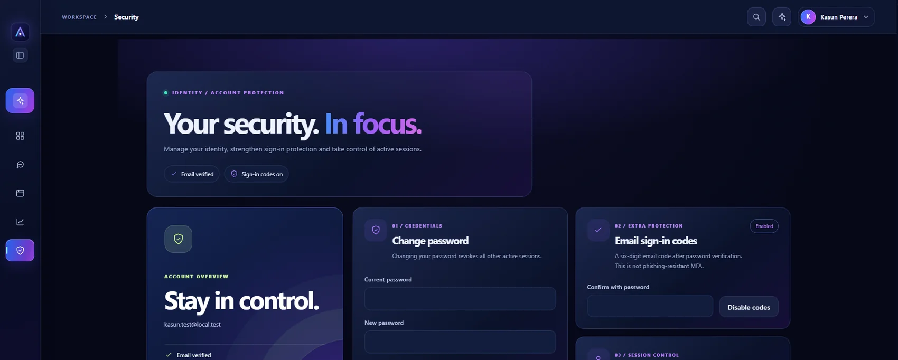
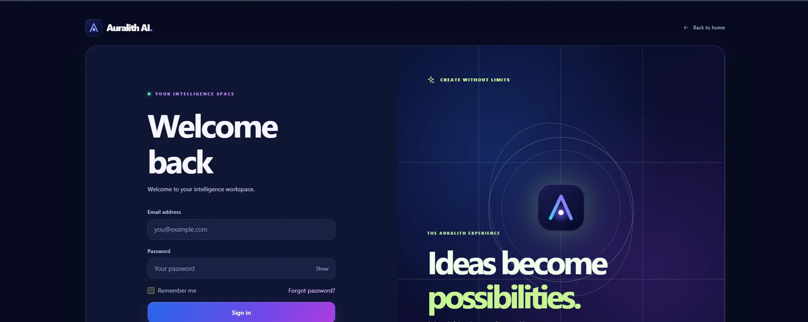
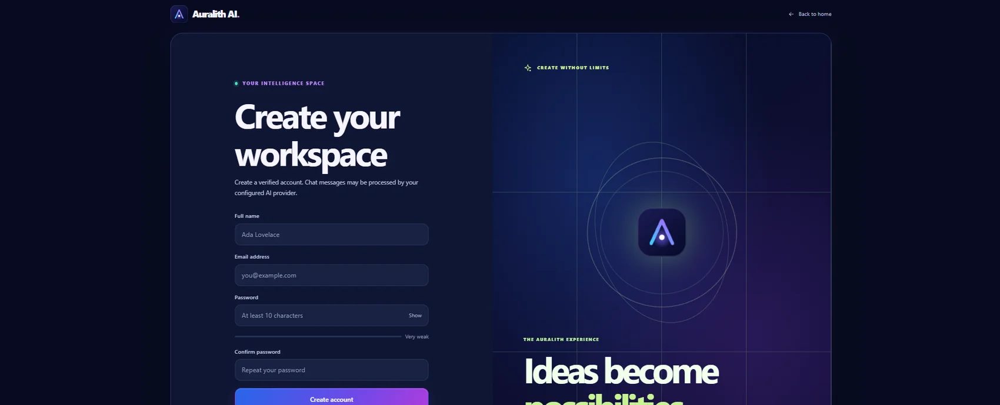
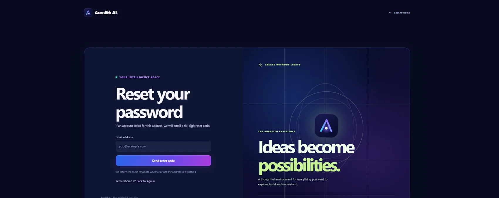
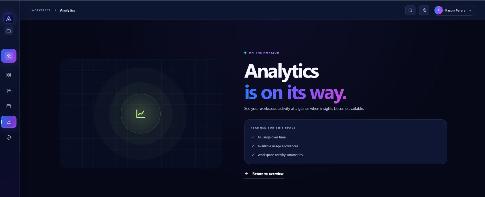

<div align="center">



# Auralith AI

### A thoughtfully engineered, full-stack AI workspace

**Private codebase · Public engineering showcase · Active development**

Explore an AI-powered workspace that brings together **secure accounts, conversational AI, project workspaces, document knowledge and session controls** in a cohesive dark-mode web experience.

[**Product tour**](#the-product-experience) · [**Engineering**](#engineering--architecture) · [**Security**](#security-by-design) · [**Current status**](#development-status)

</div>

> **Portfolio note:** This is a public, source-free showcase. The complete application is maintained in a **private GitHub repository**. The posters are **promotional compositions** based on the actual UI, not exact live screenshots; authentic application captures appear below. This project is not advertised as a deployed or production-certified service.

---

## The product experience



<sub>Promotional artwork — inspired by actual product screens. Feature availability is described accurately below; the Analytics page currently displays a coming-soon state.</sub>

### Real application screenshots

The following captures are from a running local build of Auralith AI on **24 November 2026**. They show a development/test account with sample workspace data. Screenshots are cropped to remove the Windows desktop activation overlay; the product UI has not been replaced with generated mockups.

<table>
<tr>
<td width="50%" align="center"><br/><b>01 · Workspace overview</b><br/>Dashboard, workspace navigation and project summaries</td>
<td width="50%" align="center"><br/><b>02 · AI Studio</b><br/>Chat interface, conversation history and context controls</td>
</tr>
<tr>
<td align="center"><br/><b>03 · Workspaces</b><br/>Organized spaces and workspace switching</td>
<td align="center"><br/><b>04 · Account security</b><br/>Password, email sign-in codes and sessions</td>
</tr>
<tr>
<td align="center"><br/><b>05 · Sign in</b><br/>A branded, responsive authentication experience</td>
<td align="center"><br/><b>06 · Create account</b><br/>Registration with email verification flow</td>
</tr>
<tr>
<td align="center"><br/><b>07 · Password reset</b><br/>Email code-based account recovery flow</td>
<td align="center"><br/><b>08 · Analytics preview</b><br/>Planned capability — <b>not yet a live analytics dashboard</b></td>
</tr>
</table>

---

## Capabilities

| Area | What is implemented or demonstrated |
|:---|:---|
| **Identity & access** | Registration, email verification, password login, email OTP flows, password reset and session controls |
| **AI Studio** | Conversational interface, stored chat history and provider integration paths; live provider usage requires configuration and availability |
| **Workspaces** | Owner-scoped project spaces, workspace switching and authorization boundaries |
| **Documents & knowledge** | Workspace document ingestion, listing and retrieval pathways; lexical fallback when embeddings are unavailable |
| **Security controls** | Password management, session revocation, validation and fail-closed dependency handling |
| **Analytics** | UI preview / roadmap feature; usage charts are **not implemented as a finished analytics product** |

## Engineering & architecture

Built as a TypeScript monorepo with a deliberate separation between UI, API contracts and application services.

```text
                         AURALITH AI
                   Full-stack web workspace

   React 19 + Vite + Tailwind CSS 4  (apps/web)
                     |
             HTTPS / API calls
                     |
        Fastify 5 + TypeScript      (apps/api)
          |        |         |
       Auth &   Workspace   AI / Retrieval
       Sessions  Documents  Providers
          |        |         |
          +--------+---------+
                     |
          Shared Zod contracts     (packages/shared)
                     |
       Local development / PostgreSQL-oriented persistence
       (environment-dependent, migration safeguards required)
```

| Layer | Stack |
|---|---|
| Frontend | React 19, TypeScript, Vite, Tailwind CSS 4 |
| Backend | Fastify 5, Node.js, TypeScript |
| Validation / contracts | Zod and shared TypeScript packages |
| AI integration | Groq and Ollama integration paths; configured provider availability varies |
| Persistence | Development-memory and PostgreSQL-oriented implementation |
| Testing / quality | Vitest, ESLint, TypeScript, production build verification |
| CI | GitHub Actions, Windows runner, Node.js 22 application verification |

### Engineering validation

| Check | Latest documented result |
|---|---|
| Automated tests (local publication snapshot) | **433 passed**, 5 skipped; 36 test files passed |
| Lint / typecheck / web and API builds | **Passed** |
| Private source history security scan | Gitleaks: **0 findings** (not a security certification) |
| GitHub Actions after action upgrades | **Success** on private commit `2eb76ae` (24 Nov 2026) |
| Production deployment | **Not verified** |

> The CI run is in the private source repository, so this public showcase does not embed a CI badge that external visitors might be unable to load.

---

## Security by design

The implementation explores practical application-security controls:

- Server-side validation, authorization boundaries and workspace-scoped access.
- Email verification and optional email sign-in code workflows.
- Password hashing and password-reset processes.
- Account session management and revocation.
- Secret-aware configuration, local-only database connection safeguards and redacted logging.
- Explicit migration review procedures rather than automatic database mutation during ordinary startup.

**Security is an engineering discipline, not a badge:** successful automated checks and a scanner reporting no findings do not demonstrate comprehensive penetration-testing coverage or production readiness.

## Development status

| Area | Status |
|---|---|
| Functional UI and authenticated development workflows | Implemented / demonstrated locally |
| CI verification on GitHub | Passing for the documented snapshot |
| PostgreSQL configuration and migration tooling | Implemented; deployment-specific validation required |
| Live Groq / Ollama inference | Depends on live credentials, installed models and runtime environment |
| Analytics dashboards and usage accounting | Planned / incomplete |
| Public deployment and production hardening | Not complete |

The goal is to demonstrate **incremental, evidence-based software engineering**: observable behavior, safe change management, clear architectural boundaries and honest documentation of what is still in progress.

## Repository access and intellectual property

| Repository | Visibility | Purpose |
|---|---|---|
| [`dasunwijayathilaka/auralith-ai-showcase`](https://github.com/dasunwijayathilaka/auralith-ai-showcase) | **Public** | This portfolio presentation, screenshots and conceptual promotional artwork |
| `dasunwijayathilaka/auralith-ai` | **Private** | Complete application source, tests, schema tooling and implementation docs |

The source code is **not** distributed through this showcase. The private source project is marked `UNLICENSED`; no MIT or other permissive license is granted here.

## Contact

Created and maintained as a software engineering portfolio project. For professional inquiries, see the [GitHub profile](https://github.com/dasunwijayathilaka).

---

<div align="center">

**Auralith AI** · Build thoughtfully. Verify continuously. Document precisely.

<sub>© 2026 Auralith AI showcase. All rights reserved. No permission to reuse the showcase materials is granted.</sub>

</div>
